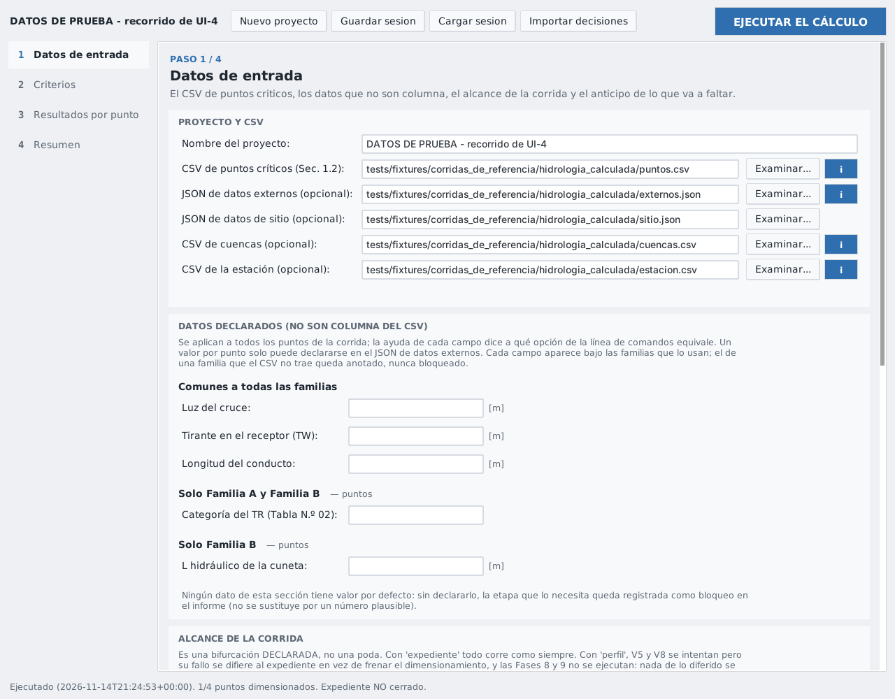
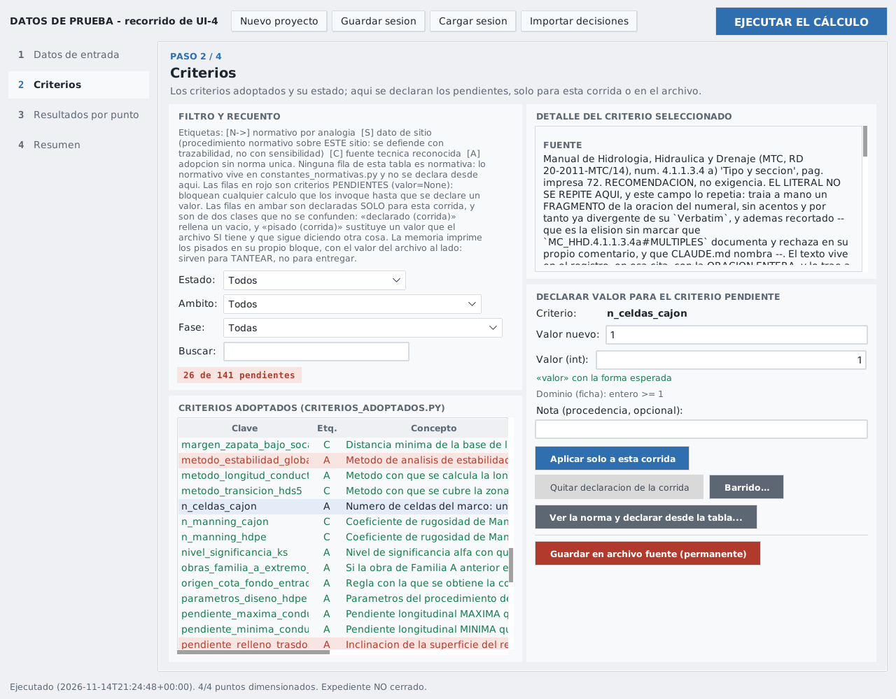
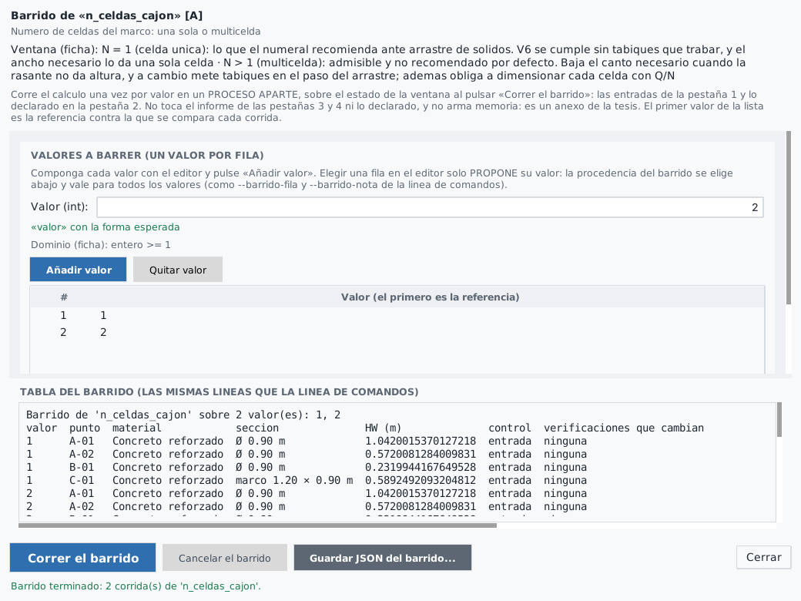
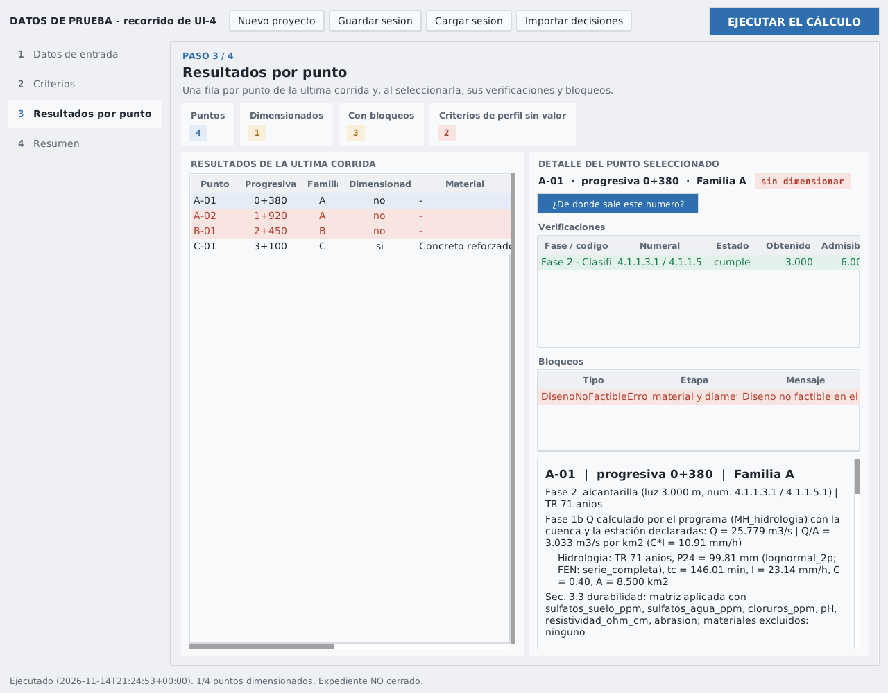
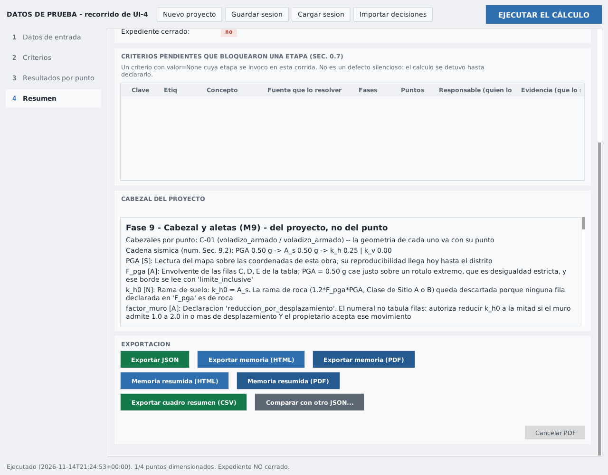

# Alcantarillas de cruce de carretera — diseño con memoria de cálculo auditable

Programa de la tesis de ingeniería civil que **dimensiona alcantarillas de cruce de
carretera** en el Perú —tubo de concreto, de metal corrugado (TMC) o de polietileno
(HDPE), y marco de concreto para cruces de canal— y **emite la memoria de cálculo** que lo
sostiene: cada paso con su fórmula sustituida, su cita (numeral, página y texto literal de
la fuente) y su veredicto, y cada valor con su etiqueta —norma peruana `[N]`, analogía
`[N→]`, dato de sitio `[S]`, fuente técnica reconocida `[C]` o adopción declarada `[A]`
con su ventana de sensibilidad—. La fuente normativa del proyecto es
`docs/hoja_de_ruta_alcantarillas_v8.md`, y las reglas técnicas del código están en
`CLAUDE.md`.

El programa **no rellena ninguna entrada de diseño**: el caudal, las cotas, el CBR, el
nivel del cuerpo receptor o los parámetros del estudio de mecánica de suelos son datos del
proyecto. Si falta uno, la etapa que lo necesita se detiene y dice qué dato la destraba.

Este archivo es el **README de usuario**: instalación, entradas, corrida y salidas. El
material del proceso de desarrollo (cadenas de prompts, auditorías, tracker de hallazgos,
bitácora de la suite) está en `proceso/` del repositorio —su README es
`proceso/README.md`— y **no es parte del entregable**: una exportación (`git archive`, la
descarga ZIP) no lo lleva.

---

## 1. Instalación

Python **3.11 o superior**. Desde la raíz del clon:

```
pip install -r requirements.txt
```

`requirements.txt` fija las versiones. Para **calcular** bastan `numpy` y `scipy`; la
ventana necesita `ttkbootstrap` y el PDF directo de la memoria `weasyprint` (sin él, la
memoria sale en HTML para imprimir con `Ctrl+P`). `pytest` sirve para comprobar el
programa (§7). `pyproject.toml` declara las mismas dependencias, separadas en obligatorias
y opcionales (`gui`, `pdf`, `test`); el programa se usa desde el clon y **no se instala
como paquete** (la memoria lee la hoja de ruta de `docs/` por su posición en el árbol).

### WeasyPrint en Windows

En Linux y macOS normalmente no hay nada que hacer. En **Windows**, `pip install
weasyprint` no instala las librerías nativas de las que depende (GTK: GObject, Pango,
Cairo, GDK-PixBuf), y sin ellas el paquete no carga. **La exportación no se pierde**: el
programa escribe la memoria en HTML junto al destino y la abre en el navegador para
guardarla con `Ctrl+P → Guardar como PDF` (la plantilla ya está en A4 con su CSS de
impresión). El mensaje de error nombra la biblioteca concreta que falta. La vía que la
documentación de WeasyPrint recomienda es **MSYS2**: instalarlo desde
<https://www.msys2.org/>, ejecutar `pacman -S mingw-w64-x86_64-pango`, añadir
`C:\msys64\mingw64\bin` al `PATH` del usuario, abrir una consola nueva y comprobar con
`python -c "import weasyprint; print(weasyprint.__version__)"`. La documentación al día:
<https://doc.courtbouillon.org/weasyprint/stable/first_steps.html>.

## 2. Los PDF de las normas: `NORMAS_DIR`

**Calcular no necesita ningún PDF.** Verificar las citas contra su fuente sí (los tests
`pytest -m pdf` y `python -m src.normativa.extraccion`), y los PDF **no están en este
repositorio**: viven en el repositorio de normas, que se clona aparte y se enlaza con una
variable de entorno:

```
git clone https://github.com/Andy-rba30/Normas.git /ruta/a/Normas
export NORMAS_DIR=/ruta/a/Normas
```

Sin la variable, todo lo que abre un PDF se salta diciéndolo; con ella apuntando a una
carpeta que no existe, falla en voz alta. **Se recomienda que el repositorio de normas sea
PRIVADO**: lleva documentos con copyright (AASHTO LRFD, AASHTO M 36 y M 170M, ASTM A760 y
A796, entre otros) que no pueden redistribuirse públicamente. Los dieciocho PDF que hasta
la versión de sustentación estaban en `normas/` de este repositorio se retiraron (eran
idénticos, byte a byte, a los del repositorio de normas), pero **siguen en el historial de
git** de los commits anteriores: retirarlos también de la historia exige reescribirla, y
es una decisión del autor.

## 3. Entradas

Qué recibe el programa, de qué estudio sale cada dato y quién lo aporta está en
**[`docs/contrato_entradas.md`](docs/contrato_entradas.md)**. En resumen:

| Entrada | Cómo entra | Qué es |
|---|---|---|
| CSV de puntos críticos | argumento posicional de `cli.py` | una fila por cruce: progresiva, familia (A, B o C), cotas, pendiente del cauce, esviaje, CBR, caudal… (columnas en el contrato) |
| Datos externos | `--datos-externos datos.json` | lo que no es columna del CSV: TW, sección del receptor, cotas de afectación, datos del cabezal, ensayos de durabilidad… |
| Cuenca y lluvia | `--cuencas cuencas.csv --estacion estacion.csv` | para que el programa calcule el caudal por el método racional cuando la celda `Q_m3s` va vacía |
| Datos de sitio de otra obra | `--datos-sitio sitio.json` | los `[S]` del corredor (PGA, corredor) con su trazabilidad y fecha |
| Criterios declarados | `--declarar CLAVE=VALOR` | el valor de un criterio `[A]` para esta corrida, dentro de su ventana |

En la ventana, cada una de estas entradas es un campo de la pestaña 1, y los criterios se
declaran en la pestaña 2 (§4, «La ventana»). De un CSV nuevo a las tres familias
dimensionadas a nivel de perfil, paso a paso y con comandos que la suite ejecuta:
**[`docs/guia_perfil.md`](docs/guia_perfil.md)**.

**Otra obra sobre el mismo despliegue.** Los datos de sitio `[S]` del corredor de la obra
del repositorio viven en `src/datos_sitio.py` con su trazabilidad y **no se editan** para
calcular otra obra: otra obra declara los suyos con `--datos-sitio sitio.json`, con
trazabilidad y fecha, y pasan por la misma guardia que el archivo:

```json
{"PGA_roca_B": {"valor": 0.30, "trazabilidad": "lectura del mapa ...", "fecha": "2026-09-21"},
 "corredor_del_proyecto": {"valor": "Obra B, km 10-12", "trazabilidad": "...", "fecha": "2026-09-21"}}
```

La memoria y el JSON imprimen de qué archivo salió cada `[S]`. En la ventana es el campo
«JSON de datos de sitio» de la pestaña 1, y «Nuevo proyecto» abre una obra vacía.

> Los archivos de `tests/` (el CSV `tests/ejemplo_puntos.csv`, `tests/fixtures/`, la línea
> base de `tests/linea_base_familia_c/`) son **DATOS DE PRUEBA, NO DEL PROYECTO**: sirven
> para ejercitar el programa y lo dicen en su cabecera. Ningún número que produzcan es un
> resultado de la obra.

## 4. Corrida

```
python cli.py puntos.csv --alcance perfil|expediente [--datos-externos datos.json] \
       [--html memoria.html] [--html-resumida resumida.html] [--csv-resumen cuadro.csv]
python -m gui.app          # la ventana
```

- **`--alcance perfil`** dimensiona el conducto (hidráulica, verificaciones, geometría,
  protección) y difiere al expediente lo estructural y el cabezal; **`--alcance
  expediente`** (por defecto) corre todo. Lo diferido se declara, con su fundamento, y no
  cuenta para el cierre.
- **`--prevuelo`** dice, sin correr nada, qué datos faltan punto a punto y si detienen una
  etapa.
- **`--sesion sesion.json`** repone una sesión guardada desde la ventana (CSV, datos
  externos, datos de sitio, los dos CSV de la hidrología —cuencas y estación, desde el
  formato 4—, alcance y criterios declarados) y dice si la corrida reproduce la guardada;
  una bandera escrita, `--cuencas` o `--estacion` incluidas, gana a lo que la sesión trae.
- **`--barrido CLAVE=v1,v2,v3`** recorre un criterio `[A]` dentro de su ventana y compara
  cada corrida con la primera (no escribe memoria); en la ventana, «Barrido…» de la
  pestaña 2.
- **`--comparar A.json B.json`** compara dos informes por identidad de punto.
- **El caudal de diseño** de un punto de Familia A o B entra declarado en la columna
  `Q_m3s` o lo calcula el programa si la celda va vacía y la corrida trae
  `--cuencas` y `--estacion` (en la ventana, los dos CSV de la pestaña 1); un caudal
  declarado gana y no se recalcula.

Código de salida de la CLI: `0` si el expediente cierra, `1` si corre y no cierra (hay
etapas bloqueadas, puntos sin dimensionar o verificaciones incumplidas), `2` si no se
puede correr (una entrada que no se puede leer).

### La ventana

`python -m gui.app` abre la ventana, que hace lo mismo que las banderas de arriba en cuatro
pasos numerados a la izquierda; arriba quedan «Nuevo proyecto», «Guardar sesion», «Cargar
sesion», «Importar decisiones» y «EJECUTAR EL CÁLCULO». Con las mismas entradas, la ventana
y la CLI escriben el mismo JSON, y el detalle de un punto y el cabezal del proyecto son,
palabra por palabra, lo que la CLI imprime.

**Pestaña 1 · Datos de entrada.** El nombre del proyecto, el CSV de puntos, el JSON de
datos externos, el JSON de datos de sitio y —para que el programa calcule el caudal de los
puntos con la celda `Q_m3s` vacía— el «CSV de cuencas» y el «CSV de la estación», que van
juntos (cada campo con «Examinar...» y, los que la tienen, su ayuda «i»). Debajo, los datos
declarados que no son columna del CSV, el alcance de la corrida (perfil o expediente) y el
anticipo de lo que va a faltar punto a punto, que es lo que `--prevuelo` imprime. Cambiar
el CSV de puntos o uno de los dos CSV de la hidrología —escribir en su campo, también la
misma ruta otra vez, porque el archivo pudo cambiar en disco— retira el informe de la
corrida anterior, y la exportación queda apagada hasta volver a ejecutar.



**Pestaña 2 · Criterios.** Cada criterio con su etiqueta y su estado, filtrable. Al
seleccionar uno se ve su ficha y se declara para la corrida con su editor y «Aplicar solo a
esta corrida» (con la nota, cuando la declaración la exige: un dato de ensayo, una adopción
que no sale de una fila de su tabla). «Barrido…» recorre el criterio seleccionado dentro de
su ventana de sensibilidad: en una ventana aparte se compone la lista de valores, el barrido
corre en un proceso aparte con lo que está en las pestañas 1 y 2, y su tabla —las mismas
líneas que `--barrido`— se guarda con «Guardar JSON del barrido...». No toca el informe de
las pestañas 3 y 4 ni lo declarado, y no escribe memoria.





**Pestaña 3 · Resultados por punto.** Una fila por punto; al seleccionar una, sus
verificaciones, sus bloqueos y el detalle: el caudal (declarado, o calculado por el
programa con su lluvia, su tiempo de concentración y su área), la sección y el control,
la protección de entrada y de salida (Fase 6), lo estructural del conducto (Fase 8) y los
dos cabezales del punto (Fase 9).



**Pestaña 4 · Resumen.** El estado del expediente, los criterios pendientes que detuvieron
una etapa, el panel «Cabezal del proyecto» (la suma de los cabezales, la cadena sísmica,
los recubrimientos, las cuantías, las notas y lo que detuvo la Fase 9) y la exportación:
«Exportar JSON», la memoria completa («Exportar memoria (HTML)» y «Exportar memoria
(PDF)»), la memoria resumida («Memoria resumida (HTML)» y «Memoria resumida (PDF)»),
«Exportar cuadro resumen (CSV)» y «Comparar con otro JSON...». Los dos PDF se escriben en un
proceso aparte: la ventana sigue viva, muestra el progreso y se puede cancelar («Cancelar
PDF»), y por encima de 40 puntos la completa ofrece la vía del navegador.



**La sesión.** «Guardar sesion» escribe en un JSON lo de las pestañas 1 y 2 —las rutas, las
de la hidrología incluidas, el alcance, los criterios declarados con su procedencia y los
datos de sitio declarados— y las corridas con su informe; «Cargar sesion» la repone tal
cual (una sesión guardada antes de que la ventana conociera la hidrología se abre igual y,
al guardarla, se reescribe en el formato actual); «Nuevo proyecto» abre una obra vacía e
«Importar decisiones» suma los criterios declarados de otra sesión. Lo que sólo hace la
CLI es escribir las dos memorias en una sola invocación —la vía en que la resumida nombra
el archivo de su completa (§5)— y forzar otra plantilla de memoria (`--plantilla`).

Las capturas son de DATOS DE PRUEBA —la corrida de referencia `hidrologia_calculada` y, la
del barrido, la de la guía de perfil— y las regenera el recorrido de la ventana que la suite
ejecuta: `xvfb-run -a python -m tests.apoyo.gui_ui4_recorrido_real <salida> --capturas
docs/capturas_interfaz` (hace falta ImageMagick).

## 5. Salidas

| Salida | Bandera | Qué lleva |
|---|---|---|
| Informe en JSON | `--json informe.json` (por defecto, `<csv>.informe.json`) | todo lo que la corrida estableció, punto a punto, con las huellas de la corrida |
| **Memoria completa** (anexo digital) | `--html` / `--pdf` | cada paso con su fórmula sustituida, su cita literal y su veredicto; criterios con justificación y fuente; acotaciones, umbrales, discrepancias y anexos |
| **Memoria resumida** (para imprimir) | `--html-resumida` / `--pdf-resumida` | por punto: resultado, veredictos, avisos, criterios `[A]` y lo que detuvo una etapa; cuadro resumen y pendientes |
| Cuadro resumen | `--csv-resumen cuadro.csv` | una fila por punto (entregable 3 de la Fase 11) |

**Las dos memorias son dos vistas de la MISMA corrida**: salen del mismo informe, llevan el
mismo encabezado de trazabilidad (huellas del CSV, de los criterios y de la hoja de ruta, y
hora de la corrida) y la resumida no publica ningún número que la completa no tenga. Se
escriben en la misma invocación (`--html completa.html --html-resumida resumida.html`) y la
resumida nombra a su completa. Desde la ventana (pestaña 4) se exportan las dos:
«Exportar memoria (HTML/PDF)» y «Memoria resumida (HTML/PDF)». Las dos en HTML salen del
informe de la última corrida y llevan el mismo encabezado; las dos en PDF las escribe el
proceso aparte, que **vuelve a correr la obra** con la sesión de esa corrida, de modo que su
encabezado lleva la hora de esa nueva corrida (y las huellas de los archivos tal como estén
al exportar). Con la CLI, también a partir de la sesión guardada (`python cli.py --sesion
sesion.json --html completa.html --html-resumida resumida.html`), que es la única vía en que
la resumida nombra el archivo de su completa. Fuera de esa vía la resumida no afirma que su
completa sea de la misma corrida: dice lo que el encabezado prueba —de la misma corrida,
coinciden la hora UTC de la corrida y las huellas del CSV, de los criterios y de la
hidrología; si alguna difiere, son dos corridas; que coincidan no lo prueba, porque la hora
va al segundo y las huellas no cubren lo declarado para la corrida ni los datos externos o
de sitio—. La huella de la hoja de ruta y la fecha de generación se leen al exportar cada
vista y no cuentan para esto.

Las memorias en PDF (y el HTML que la vía del navegador deja para `Ctrl+P`) se escriben
primero en un archivo temporal oculto del mismo directorio y sólo al terminar reemplazan al
destino: si la escritura falla a mitad (disco lleno, cuota), el archivo que hubiera en el
destino queda como estaba. Si el destino es un enlace simbólico se reemplaza el archivo
enlazado, y un archivo que ya existía conserva sus permisos. Un destino sin permiso de
escritura se rechaza, y en un directorio que no admite el temporal (sin permiso de
escritura) un destino escribible se escribe directo, sin esa garantía; los errores nombran
el destino.

## 6. Alcance: lo que el programa NO hace

Por decisión declarada (cada punto con su ficha en
[`docs/decisiones_diferidas.md`](docs/decisiones_diferidas.md) y su símbolo; la misma lista
la imprimen la memoria, la CLI y el JSON, `modelos.ALCANCE_DECLARADO`):

- **El armado de la sección del marco de concreto de la Familia C** no se diseña: el
  expediente llega al dimensionamiento y a la demanda de la losa superior (ficha T5-07).
- **El cabezal paralelo a la vía** no se calcula: en las tres familias el cabezal es
  normal al eje del conducto (ficha T7A-03).
- **El ancho de la zapata del cabezal no se itera**: la geometría la propone una regla o
  la declara el proyectista, y la estabilidad la juzga como llega (ficha T7B-09).
- **V7 del marco no pesa el concreto del marco** (del lado seguro), hasta tener la sección
  real del canal (ficha T3-08).
- **Las Figuras 3.3 y 3.4 de HEC-14 no están digitalizadas**: el contraste de la
  velocidad de salida con la Tabla N.º 11 es un indicador que no concluye (ficha T8-08).
- **En la banda de régimen de M4** la velocidad que llega a la Fase 6 es la crítica y no
  `max(V_c, V_erosion)`; la Fase 6 lo avisa con las dos velocidades (ficha T8-09).
- **El escalón de la regla de control de salida del HDS-5 en HW/D = 1.2** no se suaviza:
  es el umbral que la fuente escribe (ficha T7V-01).

Además: **no produce planos** (la memoria no remite a láminas); **la hidrología es la del
método racional** del Manual de Hidrología del MTC (cuencas de menos de 10 km²; fuera de su
dominio, el cálculo se detiene y lo dice), con el tiempo de concentración de las fórmulas
de la Tabla N.º 05 o de Témez y la lluvia de diseño ajustada a la serie de la estación; y
**las entradas del proyecto** —estudio hidrológico, ANA o Junta de Usuarios, EMS,
topografía, trazo— no las sustituye nada.

## 7. Comprobar el programa

```
pip install -r requirements-dev.txt          # PyMuPDF (y openpyxl, del proceso)
export NORMAS_DIR=/ruta/a/Normas
python -m pytest -q
```

`python -m pytest` desde la raíz corre la **suite del entregable** (`tests/`). El conteo
es un **par** —`passed` y `skipped`— que depende del entorno: sin PyMuPDF, sin ventana Tk,
sin `NORMAS_DIR` o sin un intérprete POSIX (`sh` o `bash`, que regenera la línea base) se
saltan los tests que lo necesitan, diciendo por qué; y fuera de un checkout de git (una
exportación, la descarga ZIP) se saltan además los que leen lo versionado. Lo que no
depende del entorno es la suma: si `passed + skipped` deja de dar `collected`, hay un
fallo. La línea base de la Familia C (`tests/linea_base_familia_c/`) fija byte a byte lo
que el programa escribe sobre el CSV de ejemplo —más el rótulo de fixture que su
generador, `regenerar.sh`, le pone a cada memoria—: un cambio de cálculo la mueve. En un
checkout, los tests del material de proceso se corren aparte: `python -m pytest
proceso/tests`.

Medido en la versión de sustentación (2026-11-13; Python con PyMuPDF y sin ventana Tk),
sobre el commit de `main`:

| Árbol | `NORMAS_DIR` | `passed` | `skipped` | `collected` |
|---|---|---|---|---|
| checkout de git | sí | 6402 | 23 | 6425 |
| checkout de git | no | 6250 | 175 | 6425 |
| exportación (`git archive`, la descarga ZIP) | sí | 6398 | 27 | 6425 |

Ningún `failed` en ninguna de las tres. Con `NORMAS_DIR`, en el checkout se saltan los
trece de ventana real (sin Tk) y los diez de diseño de `tests/test_familias_del_csv.py`;
sin él se saltan además todos los que abren un PDF; y en la exportación, además, los
cuatro que leen lo versionado o necesitan `.git` —el arnés de mutación de
`test_ext11_mutacion`, la mitad de PC-23 de `test_ext6_registro_normativo` (`git ls-files`)
y, en `test_t12_entregable`, el de `git check-attr` y el de la exportación emulada—, cada
uno diciendo por qué. Con una ventana Tk disponible corren también los trece de ventana
real.

Medido otra vez al cerrar la cadena de interfaz (2026-11-14), esta vez **con** ventana Tk
(`xvfb-run`), ImageMagick y `NORMAS_DIR`: 6609 `passed` y 10 `skipped` de 6619 en el
checkout, y 6605 y 14 de 6619 en la exportación; los únicos saltos son los diez de diseño
y, en la exportación, los cuatro de git. Los tests de ventana real son hoy cincuenta
—veintinueve de ellos juzgan un recorrido de la ventana de extremo a extremo (§4, «La
ventana»)— y, sin Tk, se saltan diciéndolo.

## 8. Trabajo posterior a la cadena de desarrollo

Aprobado por el autor y **no lanzado** todavía:

- Digitalizar las **Figuras 3.3 y 3.4 de HEC-14** (tirante de borde a la salida), para
  que el contraste de la velocidad de salida concluya (ficha T8-08).
- **`max(V_c, V_erosion)` en la banda de régimen de M4**, junto con lo anterior (ficha
  T8-09).
- Un **juego de cuencas de prueba coherente** para validar de punta a punta la cadena
  «caudal calculado → diseño», que hoy no está validada con datos coherentes
  (`docs/validacion_integral.md`); para la tesis, lo que importa es contrastar los caudales
  del ejemplo con el estudio hidrológico real.
- Las **dos correcciones de diagnóstico de MD** de la ficha T11-03 (abiertos 3 y 4):
  detener también cuando un candidato cierra y uno anterior tenía un dato inválido, y sacar
  como dato inválido el diámetro de arranque negativo de la rama de error.
- **Abrir la forma de `n_manning_cajon`** al par del HDS-5 núm. B.3 (marco vaciado in situ),
  hoy no declarable (ficha T11-10).
- **Una guía para quien herede el código** (5 a 10 páginas, en `docs/`), cuando la app esté
  terminada (después de VE-3): mapa de módulos y fases, el recorrido de una corrida de
  punta a punta, cómo añadir un criterio o un dato de sitio y cómo regenerar los documentos
  generados y la línea base. `CLAUDE.md` tiene las reglas, pero no está escrito para una
  persona que llega nueva (decidido por el autor el 2026-11-17).

**Pendiente del autor** (no lo resuelve el programa):

- El **nombre de la carátula** en `LICENSE` y `pyproject.toml` (hoy, el usuario de GitHub
  `Andy-rba30`) y la **versión** del `pyproject.toml` (hoy `0.1.0`, un marcador).
- Los **ejemplares de normas que faltan** (`docs/manifiesto_registro_normativo.md` §2): entre
  ellos AASHTO M 294 original y un ejemplar legible de AASHTO M 170M, que destrabarían
  verificaciones hoy declaradas como pendientes.
- La **corrida de HY-8** de los puntos del proyecto, con el procedimiento y la tolerancia de
  `docs/validacion_hy8.md`, y los datos reales del proyecto en lugar de los de prueba
  (estudio hidrológico, ANA o Junta de Usuarios, EMS, topografía).

## 9. Licencia

**Todos los derechos reservados** (ver [`LICENSE`](LICENSE)). Las normas técnicas que el
programa cita no son del autor ni se licencian. Abrir el código bajo una licencia libre es
una decisión posterior a la sustentación.
